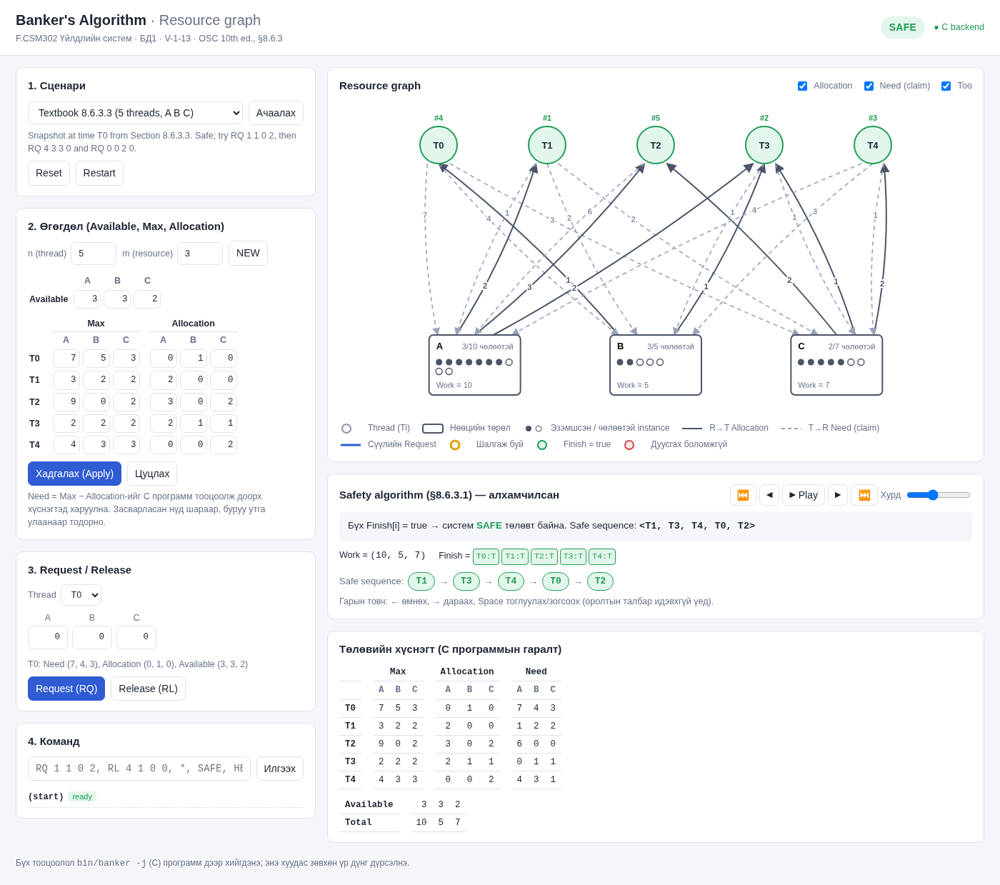

# V-1-13 – Banker's Algorithm

**F.CSM302 Үйлдлийн систем • Бие даалт 1**

| Талбар | Мэдээлэл |
|---|---|
| Хуваарилалтын код | V-1-13 |
| Төсөл | Banker's Algorithm (Programming Project, Бүлэг 8 – Deadlocks) |
| Сурах бичиг | A. Silberschatz, P. B. Galvin, G. Gagne, *Operating System Concepts*, 10th ed., Wiley, 2018 |
| UI дүрслэл | Resource graph |

## Багийн гишүүд

| № | Оюутны код |
|---|---|
| 1 | B241910044 |
| 2 | B241910014 |
| 3 | B232270148 |
| 4 | B222270050 |
| 5 | B242270026 |

## Зорилго

Сурах бичгийн 8-р бүлгийн Programming Project-д заасан **Banker's Algorithm**-ийг хэрэгжүүлсэн.
Харилцагч (thread/customer) нөөц хүсэх (`RQ`) болон чөлөөлөх (`RL`) үед банкир зөвхөн
систем **safe state**-д үлдэх тохиолдолд хүсэлтийг зөвшөөрнө (§8.6.3).

- `bin/banker` — номын шаардлагын дагуух C программ: `./bin/banker 10 5 7 8`,
  Maximum файл, `RQ` / `RL` / `*` командууд, safety algorithm (§8.6.3.1),
  resource-request algorithm (§8.6.3.2).
- **Interactive UI** — Available, Max, Allocation-ийг засварлаж, хүсэлт оруулан safe state-ийг
  шалгана. Үр дүнг **Resource graph** (assignment / claim / request edge) болон safety
  algorithm-ийн алхамчилсан харагдацаар харуулна. Бүх тооцоог C программ (`bin/banker -j`) хийнэ.



## Quick Start

Шаардлага: `gcc` эсвэл `clang` (C11), `make`, `python3` (≥ 3.7). Гадны сан хэрэггүй.
Linux, macOS эсвэл Windows-ийн WSL дээр ажиллана.

```sh
git clone https://github.com/Energyshifter8/V-1-13-Bankers-Algorithm.git
cd V-1-13-Bankers-Algorithm
make                    # bin/banker
make test               # unit + CLI + server тест
make ui                 # http://127.0.0.1:8000/ (браузер нээнэ)
```

### CLI — номын жишээ (§8.6.3.3)

```text
$ ./bin/banker -f tests/data/book_example_max.txt -a tests/data/book_example_alloc.txt 3 3 2
banker> RQ 1 1 0 2
Request GRANTED for T1: (1, 0, 2)
banker> RQ 4 3 3 0
Request DENIED for T4: (3, 3, 0) - resources are not available, customer must wait
banker> RQ 0 0 2 0
Request DENIED for T0: (0, 2, 0) - granting it would leave the system in an unsafe state
banker> SAFE
...
System is in a SAFE state. Safe sequence: <T1, T3, T4, T0, T2>
```

### CLI — номын Programming Project-ийн оролт

```text
$ ./bin/banker -f tests/data/book_project_max.txt 10 5 7 8
warning: T4 maximum of resource B (6) exceeds the system total (5); T4 can never finish
warning: the initial state is UNSAFE; every request will be denied (type SAFE for details)
banker> RQ 0 3 1 2 1
Request DENIED for T0: (3, 1, 2, 1) - granting it would leave the system in an unsafe state
```

`./bin/banker -f tests/data/book_project_max.txt 10 6 7 8` гэж B-г 6 болгоход хүсэлт зөвшөөрөгдөнө.

## Командууд

```text
banker [-j] [-f maximum_file] [-a allocation_file] r1 r2 ... rm

RQ c r1 .. rm     customer c requests resources      (номын команд)
RL c r1 .. rm     customer c releases resources      (номын команд)
*                 print available, maximum, allocation, need (номын команд)
SAFE              run the safety algorithm step by step
RESET             restore the initial state
NEW n m | AVAIL r.. | MAX c r.. | ALLOC c r.. | SAVE   edit the state
HELP | QUIT
```

## Repository бүтэц

| Зам | Агуулга |
|---|---|
| `src/core/` | C: `banker.c/.h` (алгоритм), `main.c` (CLI), `json.c/.h` (UI-д зориулсан JSON) |
| `src/ui/` | `server.py` (Python stdlib сервер), `static/` (HTML, CSS, JS – graph, stepper) |
| `tests/` | `unit_tests.c`, `run_cli_tests.sh` + `cases/` + `expected/`, `test_ui_server.py`, `data/` |
| `examples/` | UI-ийн сценари (номын жишээнүүд, өөрсдийн тестүүд) |
| `docs/` | [Тайлан](docs/V-1-13_BD1_Report.pdf), [Manual](docs/V-1-13_Manual.pdf), [ажлын төлөвлөгөө](docs/PLAN.md), зургууд |

## Тест

```text
$ make test
62 checks, 0 failed        # tests/unit_tests.c
23 passed, 0 failed        # tests/run_cli_tests.sh (tests/expected/*.out-тэй харьцуулна)
Ran 8 tests ... OK         # tests/test_ui_server.py
```

## Баримт бичиг

- [V-1-13_BD1_Report.pdf](docs/V-1-13_BD1_Report.pdf) — судалгаа, хэрэгжилт, туршилтын тайлан ([эх](docs/REPORT.md))
- [V-1-13_Manual.pdf](docs/V-1-13_Manual.pdf) — хэрэглэгчийн ба operational заавар ([эх](docs/MANUAL.md))
- PDF-ийг дахин үүсгэх: `make docs` (Chrome/Chromium ≥ 131 хэрэгтэй)

## Ашигласан сан ба эх сурвалж

- Гадны сан, framework ашиглаагүй: C стандарт сан + POSIX, Python 3 стандарт сан, браузерын стандарт API.
- Алгоритм, өгөгдлийн бүтэц, жишээ өгөгдөл: *Operating System Concepts*, 10th ed., §8.6.1–§8.6.3 ба Бүлэг 8-ийн Programming Project.
