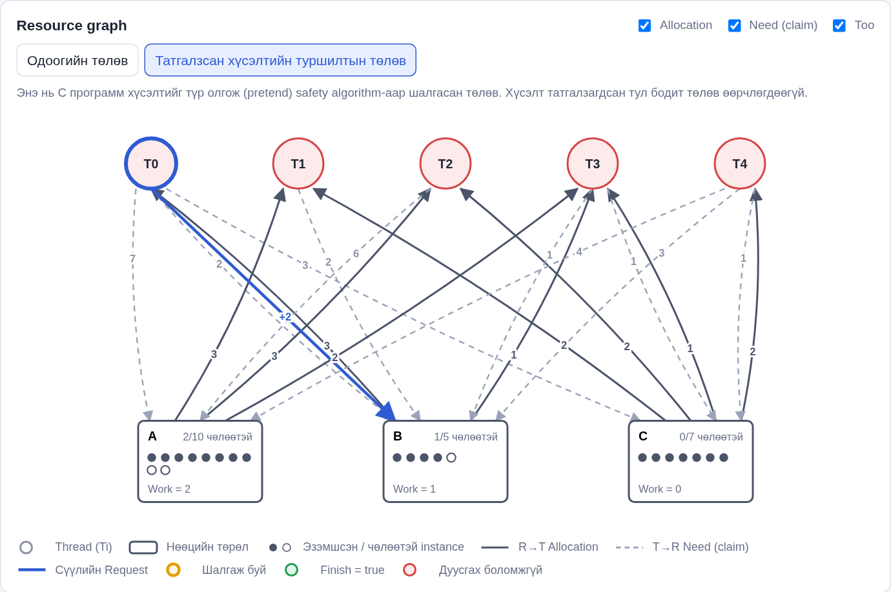

<div class="cover">
<div class="uni">ШИНЖЛЭХ УХААН, ТЕХНОЛОГИЙН ИХ СУРГУУЛЬ<br>МЭДЭЭЛЭЛ, ХОЛБООНЫ ТЕХНОЛОГИЙН СУРГУУЛЬ</div>

<div class="title">Бие даалт 1. Гарын авлага</div>
<div class="course">F.CSM302 Үйлдлийн систем</div>
<div class="term">2026-2027 оны хичээлийн жилийн намар</div>
<div class="topic"><b>Сэдэв:</b> V-1-13 Banker's Algorithm (Deadlocks)</div>
<div class="prepared">Бэлтгэсэн: /................................../ /B241910044/ Б.Тэмүүлэн</div>
<div class="members">Багийн гишүүд:<br>/B241910014/ Б.Намуунаа<br>/B232270148/ А.Бат-Эрдэнэ<br>/B222270050/ Ё.Болормаа<br>/B242270026/ Н.Лууболд</div>
<div class="checked">Шалгасан: /....................................../ Г. Ганбат /F.CS10/</div>
<div class="city">Улаанбаатар хот<br>2026 он</div>
</div>
<div class="doc-title">V-1-13 Banker's Algorithm: Manual</div>
<p class="meta"><b>Хувилбар:</b> v1.0 <b>UI дүрслэл:</b> Resource graph <b>GitHub:</b> https://github.com/Energyshifter8/V-1-13-Bankers-Algorithm</p>

# 1. Хэрэглэгчийн заавар

## 1.1 Програмын зорилго

Энэхүү программ нь *Operating System Concepts* (Silberschatz, Galvin, Gagne, 10th ed., 2018)
сурах бичгийн 8-р бүлгийн **Banker's Algorithm** Programming Project-ийг хэрэгжүүлсэн.
Харилцагч (thread/customer) нөөц хүсэх (`RQ`) болон чөлөөлөх (`RL`) үед банкир зөвхөн
систем **safe state**-д үлдэх тохиолдолд хүсэлтийг зөвшөөрнө.

Программ хоёр хэлбэрээр ажиллана:

1. **CLI** (`bin/banker`) — номд заасан командын мөрийн программ: `./bin/banker 10 5 7 8`,
   `RQ`, `RL`, `*` командууд.
2. **Interactive UI** (браузер) — Available, Max, Allocation өгөгдлийг засварлаж, хүсэлт
   оруулан safe state-ийг шалгана. Үр дүнг **Resource graph** (процесс–нөөцийн граф) болон
   safety algorithm-ийн алхамчилсан харагдацаар харуулна. UI дээрх бүх тооцоог C программ
   (`bin/banker -j`) хийнэ.

## 1.2 Дэмжих орчин

| Орчин | Төлөв |
|---|---|
| Linux (x86_64, gcc ≥ 9 эсвэл clang ≥ 10) | Туршсан (Arch Linux, gcc 16.2.1, clang) |
| macOS (Xcode Command Line Tools) | POSIX стандарт кодтой тул ажиллах ёстой (туршаагүй) |
| Windows | **WSL** (Ubuntu) дотор ажиллуулна. MinGW/MSVC-д `open_memstream` байхгүй тул шууд дэмжихгүй |
| Браузер | Chrome/Chromium, Firefox, Edge (ES module дэмждэг орчин үеийн браузер) |

## 1.3 Суулгах ба нээх алхам

```
git clone https://github.com/Energyshifter8/V-1-13-Bankers-Algorithm.git
cd V-1-13-Bankers-Algorithm
make            # bin/banker-ийг build хийнэ
make ui         # UI серверийг асаагаад браузер нээнэ (http://127.0.0.1:8000/)
```

Браузер автоматаар нээгдэхгүй бол `http://127.0.0.1:8000/` хаягийг гараар нээнэ.
Өөр порт хэрэгтэй бол: `python3 src/ui/server.py --port 8080`.

## 1.4 Оролт ба тохиргоо

### CLI-ийн оролт

```
./bin/banker [-j] [-f maximum_file] [-a allocation_file] r1 r2 ... rm
```

| Параметр | Утга |
|---|---|
| `r1 .. rm` | Нөөцийн төрөл бүрийн **Available** instance-ийн тоо (номын `./a.out 10 5 7 8`) |
| `-f maximum_file` | Харилцагч бүрийн **Maximum** шаардлага. Мөр бүр нэг харилцагч, жишээ нь `6,4,7,3` (анхдагч: `maximum.txt`) |
| `-a allocation_file` | (Нэмэлт) Харилцагч бүрт аль хэдийн олгосон **Allocation**. Номын §8.6.3.3 жишээ шиг төлөвийг ачаалахад хэрэглэнэ |
| `-j` | JSON горим: команд бүрт нэг мөр JSON хариу (UI ашиглана) |

Файлын формат: утгуудыг таслал эсвэл хоосон зайгаар тусгаарлана. `#`-ээр эхэлсэн мөр
болон хоосон мөрийг тайлбар гэж үзэн алгасна. Хязгаар: n ≤ 32 харилцагч, m ≤ 16 нөөц,
утга бүр 0..1 000 000.

### CLI командууд

| Команд | Үүрэг |
|---|---|
| `RQ c r1 .. rm` | Харилцагч `c` нөөц хүснэ (номын команд) |
| `RL c r1 .. rm` | Харилцагч `c` нөөц чөлөөлнө (номын команд) |
| `*` | Available, Maximum, Allocation, Need-ийг хэвлэнэ (номын команд) |
| `SAFE` | Safety algorithm-ийг алхам бүрээр хэвлэнэ |
| `RESET` | Анхны (эсвэл `SAVE` хийсэн) төлөв рүү буцна |
| `NEW n m` | n харилцагч, m нөөцтэй хоосон төлөв |
| `AVAIL r1 .. rm` | Available векторыг өөрчилнө |
| `MAX c r1 .. rm` | Харилцагч c-ийн Maximum-ийг өөрчилнө |
| `ALLOC c r1 .. rm` | Харилцагч c-ийн Allocation-ийг өөрчилнө |
| `SAVE` | Одоогийн төлөвийг RESET-ийн анхны төлөв болгоно |
| `WAIT c r1 .. rm` | Харилцагч c-ийн хүлээж буй хүсэлтийг (Request матриц) тохируулна, `DETECT`-д хэрэглэнэ |
| `DETECT` | Deadlock detection algorithm-ийг (§8.7.2) алхам бүрээр ажиллуулна |
| `HELP`, `QUIT` | Тусламж, гарах |

### UI-ийн самбарууд


| Самбар | Үүрэг |
|---|---|
| **1. Сценари** | `examples/*.txt` дахь бэлэн сценари (номын жишээнүүд, өөрсдийн тест) ачаалах, `Reset`, `Restart` |
| **2. Өгөгдөл** | n, m (`NEW`), Available, Max, Allocation-ийг засварлаж **Хадгалах (Apply)** дарна. Засварласан нүд шараар, буруу утга улаанаар тодорно |
| **3. Request / Release** | Thread сонгож вектор оруулаад `Request (RQ)` эсвэл `Release (RL)` дарна. Үр дүнг тайлбартай харуулна |
| **4. Команд** | CLI-ийн аливаа командыг (`RQ 1 1 0 2`, `*`, `SAFE`, `HELP` ...) шууд бичиж илгээнэ. ↑/↓ товчоор өмнөх командыг дуудна. Бүх команд ба C-ийн хариу түүхэнд хадгалагдана |
| **Resource graph** | Процесс–нөөцийн граф (доорх 1.6-г үзнэ үү) |
| **Safety algorithm** | ⏮ ◀ ▶ ⏭ товч болон **Play**-ээр safety algorithm-ийг алхамчилж үзнэ. Гарын ← → Space товч ажиллана |
| **Төлөвийн хүснэгт** | C программын буцаасан Max, Allocation, Need, Available, Total. Өөрчлөгдсөн утга цэнхэр |

## 1.5 Ажиллуулах, зогсоох, reset хийх

| Үйлдэл | CLI | UI |
|---|---|---|
| Ажиллуулах | `./bin/banker -f file.txt 10 5 7 8` | `make ui` эсвэл `python3 src/ui/server.py` |
| Зогсоох | `QUIT`, `EXIT` эсвэл Ctrl+D | Сервер ажиллаж буй терминалд Ctrl+C |
| Reset | `RESET` (анхны эсвэл `SAVE` хийсэн төлөв) | **Reset** товч (сүүлийн Apply/сценари) |
| C процессыг дахин эхлүүлэх | — | **Restart** товч (номын §8.6.3.3 жишээгээр эхэлнэ) |

## 1.6 Дүрслэлийн тэмдэг, өнгө, төлөв

| Тэмдэг | Утга |
|---|---|
| Тойрог `Ti` | Thread (харилцагч). Дээрх `#k` нь safe sequence дахь дараалал |
| Тэгш өнцөгт `A, B, ...` | Нөөцийн төрөл. Дүүрэн цэг = олгогдсон instance, хоосон цэг = чөлөөтэй. `x/y чөлөөтэй` = Available/Total |
| Хатуу саарал сум R → T | **Assignment edge**: Allocation[i][j], тоо нь instance-ийн тоо |
| Тасархай сум T → R | **Claim edge**: Need[i][j] (§8.6.2) |
| Цэнхэр бүдүүн сум T → R, `+k` | Сүүлийн **Request** |
| Шар хүрээтэй тойрог | Safety algorithm одоо шалгаж буй thread (Need ≤ Work биш) |
| Ногоон тойрог | Finish[i] = true |
| Улаан тойрог | Дуусч чадахгүй thread (unsafe) |
| `Work = x` | Алхамчлах үеийн Work векторын тухайн нөөцийн утга |
| SAFE / UNSAFE тэмдэг | Одоогийн төлөвийн safety algorithm-ийн үр дүн |

Зангилаан дээр хулганаа аваачихад зөвхөн түүний ирмэгүүд тодорч, бусад нь бүдгэрнэ.
Дээд талын `Allocation`, `Need (claim)`, `Тоо` сонголтоор ирмэг, шошгыг нууж/харуулж болно.

## 1.7 Жишээ 1 — Номын §8.6.3.3 жишээ (CLI)

```
./bin/banker -f tests/data/book_example_max.txt -a tests/data/book_example_alloc.txt 3 3 2
banker> RQ 1 1 0 2
Request GRANTED for T1: (1, 0, 2)
banker> RQ 4 3 3 0
Request DENIED for T4: (3, 3, 0) - resources are not available, customer must wait
banker> RQ 0 0 2 0
Request DENIED for T0: (0, 2, 0) - granting it would leave the system in an unsafe state
```

Энэ гурван үр дүн номын тайлбартай яг таарна: T1-ийн хүсэлт зөвшөөрөгдөж
Available = (2, 3, 0) болно. T4-ийн хүсэлтэд нөөц хүрэлцэхгүй. T0-ийн хүсэлтэд нөөц
байгаа ч олгосон тохиолдолд төлөв unsafe болно.

## 1.8 Жишээ 2 — Ижил жишээ UI дээр

1. **Сценари** самбараас *Textbook 8.6.3.3* сонгоод **Ачаалах** дарна.
2. **Request / Release** самбарт T1, (1, 0, 2) оруулаад **Request (RQ)** дарна → ногоон
   "Зөвшөөрөгдлөө" гарч, граф дээр T1-ээс A, C руу цэнхэр `+1`, `+2` сум гарна.
3. T0, (0, 2, 0) оруулаад **Request (RQ)** дарна → улаан "Татгалзсан" гарна.
4. Граф дээрх **"Татгалзсан хүсэлтийн туршилтын төлөв"** товчийг дарж ⏮ → ▶ товчоор
   алхамчлахад Work = (2, 1, 0) үед ямар ч thread-ийн Need ≤ Work нөхцөл биелэхгүй нь харагдана.



## 1.9 Жишээ 3 — Номын Programming Project-ийн оролт

```
./bin/banker -f tests/data/book_project_max.txt 10 5 7 8
warning: T4 maximum of resource B (6) exceeds the system total (5); T4 can never finish
warning: the initial state is UNSAFE; every request will be denied (type SAFE for details)
```

Номын жишээн дэх T4-ийн Maximum `5,6,7,5` нь B нөөцийн нийт тоо (5)-аас их тул
T4 хэзээ ч дуусахгүй. Тиймээс эхний төлөв unsafe бөгөөд бүх хүсэлт татгалзагдана.
Available-ийг `10 6 7 8` болгоход (`examples/04_book_project_6B.txt`) систем safe болж,
`RQ 0 3 1 2 1` зөвшөөрөгдөнө.

## 1.10 Түгээмэл алдаа ба шийдэл

| Алдаа / Мэдээлэл | Шалтгаан | Шийдэл |
|---|---|---|
| `error: cannot open 'maximum.txt'` | `-f` өгөөгүй, анхдагч файл байхгүй | `-f tests/data/book_project_max.txt` гэх мэт файлаа заана |
| `error: file.txt:2: expected 4 values, found 3` | Файлын мөрийн утгын тоо нөөцийн тоотой таарахгүй | Командын мөрийн r1..rm тоо болон файлын баганын тоог тааруулна |
| `error: invalid number 'x'`, `value -2 is negative` | Тоо биш эсвэл сөрөг утга | Сөрөг бус бүхэл тоо оруулна |
| `error: customer 7 does not exist (valid: 0..4)` | Харилцагчийн дугаар буруу | 0..n−1 хооронд дугаар өгнө |
| `Request DENIED ... exceeds the customer's remaining need` | Хүсэлт > Need (maximum claim хэтэрсэн) | Need-ээс ихгүй хүсэлт оруулна |
| `Request DENIED ... must wait` | Хүсэлт > Available | Бусад thread `RL`-ээр нөөц чөлөөлсний дараа дахин хүснэ |
| `Release DENIED ... exceeds the customer's current allocation` | Эзэмшиж буйгаасаа их чөлөөлөх гэсэн | Allocation-оос ихгүй утга өгнө |
| UI: "Сервертэй холбогдож чадсангүй" | `server.py` зогссон | `make ui`-ийг дахин ажиллуулна |
| `error: bin/banker not found` | Build хийгээгүй | `make` |
| `cannot listen on 127.0.0.1:8000` | Порт ашиглагдаж байна | `python3 src/ui/server.py --port 8080` |
| UI: Apply дарахад "C программ засварыг хүлээж аваагүй: allocation ... would exceed its maximum" | Allocation > Max | Max-ийг нэмэх эсвэл Allocation-ийг багасгана. Өмнөх төлөв рүү **Reset**-ээр буцна |

## 1.11 Жишээ 4. Deadlock detection (§8.7.2)

```
./bin/banker -f tests/data/detect_max.txt -a tests/data/detect_alloc.txt 0 0 0
banker> WAIT 1 2 0 2
banker> WAIT 3 1 0 0
banker> WAIT 4 0 0 2
banker> DETECT
...
No deadlock: every thread can finish.
banker> WAIT 2 0 0 1
banker> DETECT
...
System is DEADLOCKED. Deadlocked threads: T1 T2 T3 T4
```

`WAIT` нь thread одоо ямар нөөц хүлээж байгааг заана (Request матриц). Эзэмшиж буй
нөөц нь `-a` файлын Allocation. Юу ч эзэмшээгүй thread deadlock-д орохгүй. `RESET`
ба `NEW` Request матрицыг цэвэрлэнэ. Detection нь зөвхөн мэдээлнэ, сэргээхгүй.

# 2. Operational заавар

## 2.1 Repository clone хийх

```
git clone https://github.com/Energyshifter8/V-1-13-Bankers-Algorithm.git
cd V-1-13-Bankers-Algorithm
```

## 2.2 OS, compiler/runtime, version

| Хэрэгсэл | Шаардлагатай | Туршсан хувилбар |
|---|---|---|
| OS | Linux, macOS эсвэл Windows WSL | Arch Linux, kernel 7.2.8, x86_64 |
| C compiler | C11 + POSIX.1-2008 (`open_memstream`) | gcc 16.2.1, clang |
| Make | GNU Make | 4.4.1 |
| Python | ≥ 3.7, зөвхөн стандарт сан | 3.14.8 |
| Браузер | ES module дэмждэг | Chromium 154 |
| (Зөвхөн PDF үүсгэх) | Chrome/Chromium ≥ 131 | Chromium 154 |

## 2.3 Dependency суулгах

Гадны сан шаардлагагүй. Зөвхөн compiler, make, python3 хэрэгтэй.

```
# Ubuntu / Debian / WSL
sudo apt install build-essential python3
# Arch Linux
sudo pacman -S base-devel python
# macOS
xcode-select --install
```

## 2.4 Build ба Run команд

| Үйлдэл | Команд |
|---|---|
| Build | `make` → `bin/banker` |
| CLI ажиллуулах | `./bin/banker -f tests/data/book_example_max.txt -a tests/data/book_example_alloc.txt 3 3 2` |
| Номын оролтоор | `./bin/banker -f tests/data/book_project_max.txt 10 5 7 8` |
| Скриптээр ажиллуулах | `./bin/banker -f ... 3 3 2 < tests/cases/01_book_example.in` |
| UI | `make ui` эсвэл `python3 src/ui/server.py [--port 8000] [--open]` |
| Бүх тест | `make test` |
| Цэвэрлэх | `make clean` |
| PDF баримт үүсгэх | `make docs` |

## 2.5 Үндсэн тестийн өгөгдөл

| Файл | Агуулга |
|---|---|
| `tests/data/book_example_max.txt`, `book_example_alloc.txt` | Номын §8.6.3.3 жишээ (5 thread, A B C, Available 3 3 2) |
| `tests/data/book_project_max.txt` | Programming Project-ийн maximum файл (`10 5 7 8`) |
| `tests/data/single_resource_*.txt` | Номын §8.6.1 жишээ (12 instance-тэй нэг нөөц) |
| `tests/data/unsafe_*.txt` | Өөрсдийн тест: эхнээсээ unsafe төлөв |
| `tests/data/large_max.txt` | Өөрсдийн тест: 8 thread × 5 нөөц, хоосон зайгаар тусгаарласан |
| `examples/*.txt` | UI-ийн сценари (CLI-д ч `<` ашиглан өгч болно) |

## 2.6 Нэмэлт boundary / error тест

| Тест | Файл | Шалгах зүйл |
|---|---|---|
| Буруу аргумент | `tests/cases/10..12, 21` | Аргумент байхгүй, `abc`, `-5`, `-f` утгагүй |
| Буруу файл | `tests/cases/13..20` | Файл байхгүй, буруу баганын тоо, тоо биш, сөрөг, хоосон, Allocation-ийн мөрийн тоо, Allocation > Max |
| Буруу команд | `tests/cases/07_command_errors` | Дутуу/илүү утга, байхгүй харилцагч, сөрөг, Need-ээс их, Allocation-аас их release, тодорхойгүй команд, жижиг үсэг |
| Засварлах команд | `tests/cases/08_edit_commands` | NEW, AVAIL, MAX, ALLOC, SAVE/RESET, хязгаар (n = 0, 33) |
| Deadlock detection | `tests/cases/24_detect`, `25_detect_edge` | Номын §8.7.2 жишээ, буруу WAIT, хэтэрхий их хүсэлт, RESET |
| JSON горим | `tests/cases/09, 23` | Мөр бүрт нэг JSON, unsafe үеийн trial төлөв |
| Урт мөр | `tests/cases/22, 23` | 1022-оос урт мөр хоёр команд болж хуваагдахгүй |
| Сервер | `tests/test_ui_server.py` | API, QUIT хориглох, мөр шилжүүлэх тэмдэгтээр команд нэмэх оролдлого, batch алдаан дээр зогсох, бүх сценари ачаалагдах |

## 2.7 Хүлээгдсэн үр дүн

`make test` ажиллуулахад дараах гаралт гарна:

```
./bin/unit_tests
[PASS] need = max - allocation
[PASS] safety: textbook 8.6.3.3
...
86 checks, 0 failed
./tests/run_cli_tests.sh
[PASS] 01_book_example
...
23 passed, 0 failed
python3 -m unittest -v tests/test_ui_server.py
...
Ran 8 tests in 0.1s
OK
```

CLI тест бүрийн хүлээгдсэн гаралт `tests/expected/<нэр>.out` файлд хадгалагдсан.
Үндсэн үр дүнгүүд:

| Тохиолдол | Хүлээгдсэн үр дүн |
|---|---|
| §8.6.3.3 эхний төлөв | SAFE, `<T1, T3, T4, T0, T2>` |
| `RQ 1 1 0 2` | GRANTED, Available = (2, 3, 0) |
| `RQ 4 3 3 0` | DENIED — resources are not available |
| `RQ 0 0 2 0` | DENIED — unsafe |
| §8.6.1, `RQ 2 1` | DENIED — unsafe |
| Номын project оролт `10 5 7 8` | UNSAFE (T4 дуусч чадахгүй), бүх RQ татгалзана |
| Мөн оролт `10 6 7 8`, `RQ 0 3 1 2 1` | GRANTED |

## 2.8 Known issues

- Windows дээр MinGW/MSVC-ээр шууд build хийгдэхгүй (`open_memstream` POSIX функц). WSL ашиглана.
- Сервер нэг C процесс ашигладаг тул хэд хэдэн браузерын tab нэг төлөвийг хуваалцана
  (локал, нэг хэрэглэгчийн хэрэглээнд зориулсан).
- Thread эсвэл нөөцийн тоо их (n > 10) үед граф дээрх ирмэгүүд давхцаж уншихад хэцүү болно.
  `Need (claim)` эсвэл `Тоо` сонголтыг унтраах, эсвэл зангилаан дээр хулгана аваачих замаар шүүнэ.
- Safety algorithm thread-уудыг индексийн дарааллаар шалгадаг тул олон боломжит safe sequence-ээс
  нэгийг нь харуулна. Жишээ нь номд `<T1, T3, T4, T2, T0>` гэж өгсөн бол программ
  `<T1, T3, T4, T0, T2>` гэж олно. Хоёулаа зөв.
- UI-ийн Apply нь засваруудыг дараалан илгээдэг. Дунд нь C алдаа илрүүлбэл түүнээс өмнөх
  засвар хэрэгжсэн хэвээр үлдэнэ (SAVE хийгдэхгүй). **Reset** дарж өмнөх төлөв рүү буцна.
- Командын мөрийн урт 1022 тэмдэгт, n ≤ 32, m ≤ 16, утга ≤ 1 000 000.
