<div class="cover">
<div class="uni">ШИНЖЛЭХ УХААН, ТЕХНОЛОГИЙН ИХ СУРГУУЛЬ<br>МЭДЭЭЛЭЛ, ХОЛБООНЫ ТЕХНОЛОГИЙН СУРГУУЛЬ</div>

<div class="title">Бие даалт 1. Тайлан</div>
<div class="course">F.CSM302 Үйлдлийн систем</div>
<div class="term">2026-2027 оны хичээлийн жилийн намар</div>
<div class="topic"><b>Сэдэв:</b> V-1-13 Banker's Algorithm (Deadlocks)</div>
<div class="prepared">Бэлтгэсэн: /................................../ /B241910044/ Б.Тэмүүлэн</div>
<div class="members">Багийн гишүүд:<br>/B241910014/ Б.Намуунаа<br>/B232270148/ А.Бат-Эрдэнэ<br>/B222270050/ Ё.Болормаа<br>/B242270026/ Н.Лууболд</div>
<div class="checked">Шалгасан: /....................................../ Г. Ганбат /F.CS10/</div>
<div class="city">Улаанбаатар хот<br>2026 он</div>
</div>
<div class="doc-title">F.CSM302 Үйлдлийн систем: Бие даалт 1. Тайлан</div>
<p class="meta"><b>Хуваарилалтын код:</b> V-1-13 <b>Төсөл:</b> Banker's Algorithm (Operating System Concepts 2018, Бүлэг 8, Deadlocks) <b>UI дүрслэл:</b> Resource graph <b>Гишүүд:</b> B241910044 Б.Тэмүүлэн; B241910014 Б.Намуунаа; B232270148 А.Бат-Эрдэнэ; B222270050 Ё.Болормаа; B242270026 Н.Лууболд<br><b>GitHub:</b> https://github.com/Energyshifter8/V-1-13-Bankers-Algorithm</p>

# Хураангуй

**Асуудал.** Олон thread хязгаарлагдмал нөөцийн төлөө өрсөлдөхөд deadlock үүсч болно.
Banker's algorithm нь thread бүрийн хамгийн их шаардлагыг (Maximum) урьдчилан мэдэж,
хүсэлт бүрийг олгосны дараах төлөв **safe** эсэхийг шалгах замаар deadlock-оос зайлсхийдэг.

**Шийдэл.** Сурах бичгийн Programming Project-ийн шаардлагын дагуу C хэл дээр Banker's
algorithm-ийг (`available`, `maximum`, `allocation`, `need` бүтэц, safety algorithm,
resource-request algorithm, `request_resources()`/`release_resources()`) хэрэгжүүлэв.
Программ нь `./bin/banker 10 5 7 8` хэлбэрээр ажиллаж, Maximum файлыг уншаад `RQ`, `RL`,
`*` командыг хүлээн авна. Үүн дээр safety algorithm-ийн алхам бүрийг хэвлэх, Allocation
файл ачаалах, төлөв засварлах командууд болон UI-д зориулсан JSON горим нэмсэн.
Interactive UI нь Python стандарт сангийн жижиг сервероор дамжин **яг тэр C программыг**
ажиллуулж, хариуг нь **Resource graph** (assignment, claim, request ирмэгтэй
процесс–нөөцийн граф) ба safety algorithm-ийн алхамчилсан харагдацаар үзүүлнэ.

**Туршилт.** C unit тест (11 бүлэг, 62 шалгалт), CLI-ийн 25 тохиолдол (хүлээгдсэн
гаралттай харьцуулна), серверийн 8 integration тест бүгд амжилттай давсан.
AddressSanitizer/UBSan-тай build дээр ч алдаа гараагүй.

**Гол үр дүн.** Номын §8.6.3.3 жишээний бүх үр дүн давтагдсан: эхний төлөв safe
`<T1, T3, T4, T0, T2>`. T1-ийн (1,0,2) хүсэлт зөвшөөрөгдөнө. T4-ийн (3,3,0) хүсэлт нөөц
хүрэлцэхгүй тул хүлээнэ. T0-ийн (0,2,0) хүсэлт unsafe тул татгалзагдана. Мөн номын Programming
Project-ийн жишээ оролт (`10 5 7 8`) дээр T4-ийн Maximum (B = 6) нийт нөөцөөс (5) их тул
систем эхнээсээ unsafe байгааг программ илрүүлж анхааруулдаг.

# 1. Удиртгал

**Зорилго.** Сурах бичгийн 8-р бүлгийн Banker's Algorithm төслийг бүрэн хэрэгжүүлэх,
хэрэглэгч өөр өгөгдөл, нөхцөл, параметрээр дахин турших боломжтой болгох, ажиллагааг
Resource graph дүрслэлээр харуулах, үр дүнг тайлан болон гарын авлагаар баримтжуулах.

**Ач холбогдол.** Deadlock avoidance нь үйлдлийн системийн нөөцийн удирдлагын үндсэн
ойлголт юм. Safe state, claim edge, Need ≤ Work нөхцөл зэрэг хийсвэр ойлголтыг алхам
алхмаар, графаар харуулах нь алгоритмыг ойлгоход тусална.

**Хамрах хүрээ.**

- Номын шаардлага: n харилцагч, m нөөц, 4 өгөгдлийн бүтэц, safety ба resource-request
  algorithm, `RQ`/`RL`/`*` командууд, командын мөрөөр Available, файлаас Maximum.
- Нэмэлт: Allocation файл, `SAFE` алхамчилсан гаралт, `RESET`/`SAVE`, засварлах командууд,
  deadlock detection (`WAIT`/`DETECT`, §8.7.2), JSON горим, интерактив вэб UI,
  автомат тестүүд.
- Хамрахгүй: олон процессын бодит synchronization (номын 10-р хэвлэлийн төсөл нь
  нэг урсгалтай интерактив программ шаарддаг). Deadlock-оос сэргээх (§8.8). Detection-ийн дүрслэл UI-ийн граф дээр хараахан
  нэмээгүй (зөвхөн CLI).

# 2. Сурах бичгийн шаардлага

Номын Programming Project-ийн (Бүлэг 8, "Banker's Algorithm") үндсэн шаардлага ба
хэрэгжилт:

| № | Номын шаардлага | Хэрэгжилт | Байршил |
|---|---|---|---|
| 1 | Харилцагчид нөөц хүсэх, чөлөөлөх. Хүсэлтийг зөвхөн safe state-д үлдэх үед олгоно | `bank_request()`, `bank_release()` | `src/core/banker.c` |
| 2 | `available`, `maximum`, `allocation`, `need` бүтэц | `bank_t` бүтэц | `src/core/banker.h` |
| 3 | §8.6.3.1 safety algorithm-аар шалгах | `bank_is_safe()` | `banker.c` |
| 4 | `int request_resources(int, int[])` 0/−1 буцаана, `void release_resources(int, int[])` | Номын прототиптэй яг ижил функцууд | `src/core/main.c` |
| 5 | Request, release хийх болон бүтцүүдийг хэвлэх интерактив программ | `RQ`, `RL`, `*` командууд | `main.c` |
| 6 | Нөөцийн тоог командын мөрөөр өгөх: `./a.out 10 5 7 8`, Available-д онооно | `./bin/banker 10 5 7 8` | `main.c` |
| 7 | Харилцагч бүрийн Maximum-ийг файлаас унших (`6,4,7,3` мөрүүд) | `-f` файл, `bank_load_matrix()` | `banker.c` |
| 8 | `RQ 0 3 1 2 1` → зөвшөөрсөн/татгалзсан эсэхийг хэвлэх | `Request GRANTED/DENIED ... - шалтгаан` | `main.c` |
| 9 | `RL 4 1 2 3 1` → нөөц чөлөөлөх | `Released ... from T4` | `main.c` |
| 10 | `*` → available, maximum, allocation, need-ийг хэвлэх | Хүснэгт хэлбэрээр хэвлэнэ | `main.c` |

Номд кодын жишээ `#define NUMBER_OF_CUSTOMERS 5`, `NUMBER_OF_RESOURCES 4` гэж тогтмол
өгсөн. Бид тогтмол тоо оронд n-ийг файлын мөрийн тооноос, m-ийг командын мөрийн
аргументын тооноос тодорхойлсон (n ≤ 32, m ≤ 16). Ингэснээр "туршилтын ганц өгөгдлийг
эх кодод хатуу тогтоохгүй" гэсэн шаардлага биелнэ.

# 3. Онолын үндэс

## 3.1 Deadlock ба avoidance

Deadlock үүсэх дөрвөн зайлшгүй нөхцөл бий: mutual exclusion, hold and wait, no preemption,
circular wait (§8.3). *Avoidance* арга нь эдгээрийг шууд хориглохгүй. Харин thread бүр
хамгийн ихдээ хэдэн нөөц шаардахаа урьдчилан зарлаж (maximum claim), систем хүсэлт бүрийг
олгохын өмнө ирээдүйд deadlock үүсэх боломжгүй эсэхийг шалгана (§8.6).

**Safe state.** Хэрэв бүх thread-ийг ямар нэг дарааллаар `<T1, ..., Tn>` дуусгах боломжтой,
өөрөөр хэлбэл Ti бүрийн үлдсэн хэрэгцээг одоогийн чөлөөтэй нөөц ба өмнөх Tj (j < i)-ийн
буцаах нөөцөөр хангаж чадвал систем safe төлөвт байна. Ийм дарааллыг **safe sequence**
гэнэ. Safe төлөвт deadlock үүсэхгүй. Unsafe төлөв нь deadlock биш ч deadlock руу хүргэж
болзошгүй (§8.6.1).

## 3.2 Resource-allocation graph ба claim edge

Resource-allocation graph-д (§8.3.2) thread-ийг тойрог, нөөцийн төрлийг тэгш өнцөгт,
instance-ийг цэгээр дүрсэлнэ. *Request edge* Ti → Rj нь хүсэлтийг, *assignment edge*
Rj → Ti нь олгосон нөөцийг заана. Avoidance-ийн хувилбарт (§8.6.2) ирээдүйд хүсэж болох
нөөцийг тасархай *claim edge* Ti → Rj-ээр нэмж харуулдаг. Нөөцийн төрөл бүр нэг
instance-тэй үед мөчлөг (cycle) шалгах хангалттай. Олон instance-тэй үед Banker's algorithm
хэрэгтэй. Манай UI нь олон instance-тэй граф зурна: ирмэгийн шошго нь instance-ийн тоо,
claim edge-ийн тоо нь Need.

## 3.3 Өгөгдлийн бүтэц

n thread, m нөөцийн төрөлтэй үед (§8.6.3):

| Бүтэц | Хэмжээ | Утга |
|---|---|---|
| `Available` | m | Rj төрлийн чөлөөтэй instance |
| `Max` | n × m | Ti-ийн Rj-ээс хүсч болох хамгийн их тоо |
| `Allocation` | n × m | Ti-д одоо олгосон Rj |
| `Need` | n × m | `Need[i][j] = Max[i][j] − Allocation[i][j]` |

Вектор харьцуулалт: X ≤ Y ⇔ бүх j-д X[j] ≤ Y[j].

## 3.4 Safety algorithm (§8.6.3.1)

1. `Work = Available`, бүх i-д `Finish[i] = false`.
2. `Finish[i] == false` ба `Need_i ≤ Work` байх i-г ол. Олдохгүй бол 4-р алхам.
3. `Work = Work + Allocation_i`, `Finish[i] = true`, 2-р алхам руу буц.
4. Бүх `Finish[i] == true` бол систем safe.

Хүндрэл нь O(m × n²): гадна давталт хамгийн ихдээ n+1 удаа, дотор талд n thread, тус бүрт
m харьцуулалт хийнэ.

## 3.5 Resource-request algorithm (§8.6.3.2)

Ti-ийн `Request_i` хүсэлтэд:

1. `Request_i ≤ Need_i` биш бол алдаа: maximum claim хэтэрсэн.
2. `Request_i ≤ Available` биш бол Ti хүлээнэ: нөөц хүрэлцэхгүй.
3. Түр олгосон мэт үзнэ: `Available −= Request_i`, `Allocation_i += Request_i`,
   `Need_i −= Request_i`. Шинэ төлөв safe бол хүсэлтийг олгоно. Үгүй бол хуучин төлөвийг
   сэргээж Ti хүлээнэ.

**Нэмэлт ажиглалт.** Хэрэв одоогийн төлөв unsafe бол ямар ч хүсэлт зөвшөөрөгдөхгүй.
Учир нь хүсэлтийг олгосны дараах төлөвт safe sequence байсан гэж үзье. Тэр дарааллыг
олголтын өмнөх төлөвт хэрэглэхэд Ti дуусахаас өмнөх алхам бүрт Work нь `Request_i`-ээр
илүү, Ti-ийн Need мөн `Request_i`-ээр илүү байна. Ti дууссаны дараа хоёр төлөвийн Work
тэнцүү болно. Тэгэхээр олголтын өмнөх төлөв ч safe байх ёстой. Программ эхний төлөв unsafe
үед "every request will be denied" гэж анхааруулдаг нь үүнд үндэслэсэн.

## 3.6 Deadlock detection algorithm (§8.7.2)

Avoidance-ийн оронд системийг deadlock-д орохыг зөвшөөрч, дараа нь илрүүлэх арга
(§8.7) бий. Олон instance-тэй нөөцөд Available, Allocation болон **Request**
матриц ашиглана. `Request[i][j] = k` нь Ti одоо Rj-ийн k instance-ийг хүлээж байна
гэсэн үг.

1. `Work = Available`. `Allocation_i != 0` бол `Finish[i] = false`, үгүй бол `true`.
2. `Finish[i] == false` ба `Request_i <= Work` байх i-г ол. Олдохгүй бол 4-р алхам.
3. `Work = Work + Allocation_i`, `Finish[i] = true`, 2-р алхам руу буц.
4. `Finish[i] == false` байх бүх Ti deadlock-д орсон.

Алгоритм нь O(m × n²) хүндрэлтэй. Safety algorithm-оос гурван ялгаатай:

- Need-ийн оронд Request-ийг ашиглана.
- Юу ч эзэмшээгүй thread (`Allocation_i = 0`) эхнээсээ дууссан гэж тооцогдоно.
  Тэр thread нөөц хүлээж байсан ч хэнийг ч хаадаггүй тул deadlock-ийн мөчлөгт орж
  чадахгүй.
- Request ≤ Work болмогц Ti дараа нь нэмэлт нөөц хүсэхгүй гэж найдаж (optimistic
  assumption) түүний нөөцийг буцаана. Энэ таамаг буруу бол deadlock дараагийн
  detection дээр илэрнэ.

Practice Exercise 8.10-д заасны дагуу `Max = Waiting + Allocation` гэж тооцож
safety algorithm-ийн кодыг дахин ашиглаж болно. Гэхдээ дээрх хоёр дахь ялгаа
(`Allocation_i = 0` thread-ийг эхнээс нь дууссан гэж үзэх) нь safety algorithm-д
байхгүй тул бид тусдаа функц бичсэн.

Хэрэгжилт: `bank_detect_deadlock()` (`src/core/banker.c`) нь `bank_is_safe()`-тэй
ижил бүтэцтэй: thread-үүдийг 0..n−1 дарааллаар давтан шалгаж, нэг бүтэн давталтад
ахиц гараагүй үед зогсоно. Алхам бүрийг trace callback-аар мэдээлдэг. CLI-д хоёр
команд нэмсэн: `WAIT c r1 .. rm` нь Request матрицын мөрийг тохируулна, `DETECT`
алгоритмыг алхам бүрээр хэвлэж ажиллуулна. `RESET` ба `NEW` Request матрицыг
цэвэрлэнэ.

# 4. Системийн зохиомж

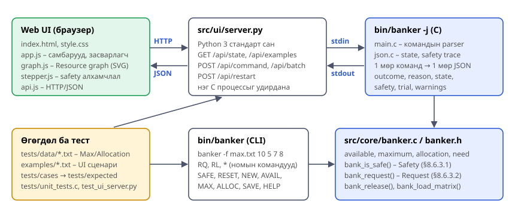

| Бүрэлдэхүүн | Файл | Үүрэг |
|---|---|---|
| Core сан | `src/core/banker.c`, `banker.h` | Өгөгдлийн бүтэц, файл унших/шалгах, safety, request, release. I/O-гүй, бусад хэсгээс хамааралгүй |
| CLI | `src/core/main.c` | Командын мөр, номын `request_resources`/`release_resources`, командын parser, хүснэгт хэвлэх |
| JSON гаралт | `src/core/json.c`, `json.h` | Төлөв, safety trace-ийг JSON болгох |
| UI сервер | `src/ui/server.py` | `bin/banker -j` процессыг ажиллуулж HTTP хүсэлтийг stdin руу дамжуулна. Static файлууд үйлчилнэ |
| Web UI | `src/ui/static/` | Засварлагч, request самбар, консол, Resource graph (SVG), stepper |
| Өгөгдөл | `tests/data/`, `examples/` | Тестийн файлууд, UI-ийн сценари (командын скрипт) |

**Өгөгдлийн урсгал (нэг хүсэлтийн жишээ).**

1. Хэрэглэгч UI дээр T0, (0, 2, 0) оруулж **Request** дарна.
2. `app.js` → `POST /api/command {"command": "RQ 0 0 2 0"}`.
3. `server.py` мөр шилжүүлэх тэмдэгтийг арилгаж, `QUIT`-ийг хориглоод C процессын stdin
   руу нэг мөр бичнэ.
4. C программ `request_resources(0, ...)` → `bank_request()` → safety algorithm-ийг
   ажиллуулж `BANK_ERR_UNSAFE` буцаана. Түр олгосон (*trial*) төлөвийг хадгална.
5. C программ нэг мөр JSON хэвлэнэ: `outcome: "denied"`, `reason: "unsafe"`, одоогийн
   `state`, `safety.steps`, `trial.state`, `trial.safety`, `warnings`.
6. UI тэр JSON-оос граф, stepper, хүснэгтийг дахин зурна. Safe эсэхийг UI өөрөө
   **тооцоолохгүй**.

**JSON протокол.** Командын мөр бүрт яг нэг JSON мөр гарна. Үүнд урт мөр болон алдаатай
команд ч хамаарна:

```
{"command":"RQ 1 1 0 2","outcome":"granted","reason":null,"customer":1,"vector":[1,0,2],
 "message":"Request GRANTED for T1: (1, 0, 2)\n",
 "state":{"n":5,"m":3,"available":[2,3,0],"maximum":[[7,5,3],...],"allocation":[...],
          "need":[...],"total":[10,5,7]},
 "safety":{"steps":[{"customer":0,"ok":false,"work":[2,3,0]},
                    {"customer":1,"ok":true,"work":[2,3,0],"next":[5,3,2]},...],
           "safe":true,"sequence":[1,3,4,0,2]},
 "trial":null,"warnings":[]}
```

# 5. Хэрэгжилт

**Хэл ба сан.** Core болон CLI нь C11 + POSIX.1-2008 (`open_memstream`, `isatty`,
`strcasecmp`) дээр бичигдсэн. UI сервер нь Python 3-ийн зөвхөн стандарт сан
(`http.server`, `subprocess`, `json`) ашиглана. Вэб UI нь HTML/CSS/JavaScript (ES module,
SVG) бөгөөд гадны сан, framework ашиглаагүй. Build хийхэд `make`, тестэд `make test`
ашиглана.

| Хэсэг | Мөр |
|---|---|
| C core + CLI + JSON (`src/core`) | 1 228 |
| UI сервер (`server.py`) | 213 |
| Web UI (HTML, CSS, JS) | 1 254 |
| Тест (`unit_tests.c`, `test_ui_server.py`, `run_cli_tests.sh`) | 427 |

**Safety algorithm** (`banker.c`). Харилцагчдыг 0..n−1 дарааллаар давтан шалгаж, нэг бүтэн
давталтад ахиц гараагүй үед зогсоно. Алхам бүрийг `trace` callback-аар мэдээлдэг тул CLI-ийн
`SAFE` команд ба JSON горим нэг л функцийг ашиглана:

```
int bank_is_safe(const bank_t *b, int sequence[], int *seq_len,
                 bank_trace_fn trace, void *ctx)
{
    int work[MAX_RESOURCES];
    int finish[MAX_CUSTOMERS] = {0};
    int done = 0, progress = 1;

    memcpy(work, b->available, sizeof(work));
    while (progress && done < b->n) {
        progress = 0;
        for (int i = 0; i < b->n; i++) {
            if (finish[i])
                continue;
            int ok = vec_leq(b->need[i], work, b->m);
            if (trace != NULL)
                trace(b, i, ok, work, ctx);
            if (!ok)
                continue;
            for (int j = 0; j < b->m; j++)
                work[j] += b->allocation[i][j];
            finish[i] = 1;
            if (sequence != NULL)
                sequence[done] = i;
            done++;
            progress = 1;
        }
    }
    if (seq_len != NULL)
        *seq_len = done;
    return done == b->n;
}
```

**Resource-request algorithm.** `bank_request()` нь §8.6.3.2-ийн гурван алхмыг яг
дагана: Need, Available шалгалт, түр олголт, safety шалгалт, unsafe бол буцаах. Буцаах
утга нь шалтгааныг ялгана (`BANK_ERR_EXCEEDS_NEED`, `BANK_ERR_UNAVAILABLE`,
`BANK_ERR_UNSAFE`). Номын интерфэйс нь үүн дээр суурилна:

```
int request_resources(int customer_num, int request[])
{
    last_status = bank_request(&bank, customer_num, request);
    return last_status == BANK_OK ? 0 : -1;
}
```

**Оролтын шалгалт.** Файлын мөр бүрийг `bank_parse_vector()` шалгана: зөвхөн сөрөг бус
бүхэл тоо, таслал ба/эсвэл хоосон зайгаар тусгаарласан, утга ≤ 1 000 000, тоо нь m-тэй
тэнцүү байх ёстой. Алдааг файлын нэр, мөрийн дугаартай мэдээлнэ
(`book.txt:2: expected 4 values, found 3`). Allocation > Max байвал ачаалахгүй. Max нь
системийн нийт нөөцөөс их thread хэзээ ч дуусахгүй тул анхааруулга гаргана. 1022-оос урт
командын мөрийг хоёр команд болгон хуваахгүй, бүтнээр нь алдаа гэж үзнэ.

**UI.** `graph.js` нь thread-үүдийг дээд мөрөнд, нөөцийн төрлүүдийг доод мөрөнд байрлуулж,
Allocation-ийг R → T хатуу, Need-ийг T → R тасархай, сүүлийн хүсэлтийг цэнхэр муруй сумаар
зурна. `stepper.js` нь C-ийн `safety.steps` trace-ийг "байрлал" болгон хувиргана:
0 = эхлэл, 1..L = алхам, L+1 = үр дүн. Байрлал бүрт thread-ийн өнгө, Work, Finish,
safe sequence-ийг тооцно. Unsafe шалтгаанаар татгалзсан хүсэлтэд `trial` төлөвийг сонгож
яагаад unsafe болохыг алхамчилж харж болно.

# 6. Туршилт ба UI дүрслэл

**Юуг өөрчилж турших вэ.**

| Өөрчлөх зүйл | Хаана |
|---|---|
| Thread ба нөөцийн тоо (n, m) | `NEW n m`, UI-ийн n/m талбар |
| Available, Max, Allocation | Командын мөр, `-f`/`-a` файл, `AVAIL`/`MAX`/`ALLOC`, UI-ийн засварлагч |
| Хүсэлт ба чөлөөлөлт | `RQ`/`RL`, UI-ийн Request/Release самбар |
| Бэлэн сценари | `examples/*.txt` (UI-ийн "Сценари" самбар) |

**Юуг ажиглах вэ.**

| Ажиглалт | Дүрслэл |
|---|---|
| Хүсэлтийн үр дүн ба шалтгаан | Ногоон/шар/улаан тайлбар + C-ийн жинхэнэ мессеж |
| Нөөцийн эзэмшил | Граф дээрх assignment edge-ийн тоо, тэгш өнцөгт доторх дүүрэн/хоосон цэг |
| Үлдсэн хэрэгцээ | Claim edge (тасархай) ба түүний тоо |
| Safety algorithm-ийн явц | Stepper: Work, Finish, шалгаж буй thread (шар), дууссан (ногоон), гацсан (улаан), `#k` дараалал |
| Unsafe болох шалтгаан | "Татгалзсан хүсэлтийн туршилтын төлөв" |
| Тоон үр дүн | Төлөвийн хүснэгт (Need, Available, Total), өөрчлөгдсөн утга цэнхэр |

Peer review-ийн "UI дүрслэлийг шалгах асуулт"-д дараах байдлаар хариулна. Оролт өөрчлөгдөхөд
бүх дүрслэл C-ийн шинэ хариугаар шинэчлэгдэнэ. Өнгө ба тоо нь C-ийн `state`/`safety`-тэй
шууд холбоотой. Legend байнга харагдана. ⏮ ◀ ▶ ⏭/Play-ээр алхамчилж эргэн шалгах боломжтой.
Stepper-ийн текст алгоритмын алхам бүрийг томьёогоор тайлбарлана.

# 7. Туршилтын арга

**Орчин.** Arch Linux (kernel 7.2.8, x86_64), gcc 16.2.1 (`-std=c11 -Wall -Wextra -pedantic`,
анхааруулгагүй), clang (анхааруулгагүй), GNU Make 4.4.1, Python 3.14.8, Chromium 154.
Санах ойн алдааг `-fsanitize=address,undefined` build дээр бүх тестийг ажиллуулж шалгасан.
Repository-г GitHub-аас шинээр clone хийж `make && make test` ажиллуулж нөхөн ажиллуулах
боломжийг баталгаажуулсан.

**Түвшин.**

| Түвшин | Хэрэгсэл | Тоо |
|---|---|---|
| Unit (core функц) | `tests/unit_tests.c` | 11 бүлэг, 62 шалгалт |
| CLI (end-to-end) | `tests/run_cli_tests.sh`: `tests/cases/*.args/.in` → `tests/expected/*.out` | 25 тохиолдол |
| UI сервер + JSON | `tests/test_ui_server.py` (unittest) | 8 тест |
| UI (гар аргаар) | Headless Chromium-оор товч дарж screenshot авсан (энэ тайлангийн зургууд) | 15 зураг |

**Төлөвлөсөн тест ба хүлээгдсэн үр дүн** (`docs/PLAN.md`):

| № | Оролт / нөхцөл | Хүлээгдсэн үр дүн | Эх сурвалж |
|---|---|---|---|
| 1 | §8.6.3.3: Available (3,3,2), Max, Allocation | Safe | Ном |
| 2 | T1 → (1,0,2) | Зөвшөөрнө, Available (2,3,0) | Ном |
| 3 | Дараа нь T4 → (3,3,0) | Нөөц хүрэлцэхгүй, хүлээнэ | Ном |
| 4 | Дараа нь T0 → (0,2,0) | Unsafe тул татгалзана | Ном |
| 5 | §8.6.1: 12 instance, T2 → 1 | Unsafe тул татгалзана | Ном |
| 6 | Project оролт `10 5 7 8`, `RQ 0 3 1 2 1` | Шаардлагын дагуу шийдвэр гаргана | Ном |
| 7 | Эхнээсээ unsafe төлөв, дараа нь RL | Unsafe → RL-ийн дараа safe | Өөрсдийн |
| 8 | 8 × 5 систем | Хоёр дахь давталтад T1, T4 дуусна | Өөрсдийн |
| 9 | Буруу/захын оролт: эхлүүлэх үеийн 12 алдаа, 13 буруу команд, урт мөр | Ойлгомжтой алдаа, программ унахгүй | Өөрсдийн |

# 8. Үр дүн

## 8.1 Номын жишээ (§8.6.3.3) — CLI-ийн бодит гаралт

```
banker> SAFE
Safety algorithm: Work = Available = (3, 3, 2)
  T0   Need (7, 4, 3) <= Work (3, 3, 2) ? no
  T1   Need (1, 2, 2) <= Work (3, 3, 2) ? yes -> Work = (5, 3, 2), Finish[1] = true
  T2   Need (6, 0, 0) <= Work (5, 3, 2) ? no
  T3   Need (0, 1, 1) <= Work (5, 3, 2) ? yes -> Work = (7, 4, 3), Finish[3] = true
  T4   Need (4, 3, 1) <= Work (7, 4, 3) ? yes -> Work = (7, 4, 5), Finish[4] = true
  T0   Need (7, 4, 3) <= Work (7, 4, 5) ? yes -> Work = (7, 5, 5), Finish[0] = true
  T2   Need (6, 0, 0) <= Work (7, 5, 5) ? yes -> Work = (10, 5, 7), Finish[2] = true
System is in a SAFE state. Safe sequence: <T1, T3, T4, T0, T2>
banker> RQ 1 1 0 2
Request GRANTED for T1: (1, 0, 2)
banker> RQ 4 3 3 0
Request DENIED for T4: (3, 3, 0) - resources are not available, customer must wait
banker> RQ 0 0 2 0
Request DENIED for T0: (0, 2, 0) - granting it would leave the system in an unsafe state
```

## 8.2 Тестийн үр дүнгийн хүснэгт

| № | Хүлээгдсэн | Бодит | Дүгнэлт |
|---|---|---|---|
| 1 | Safe | SAFE `<T1, T3, T4, T0, T2>` | ✔ (номд `<T1, T3, T4, T2, T0>`, хоёулаа зөв) |
| 2 | Зөвшөөрнө, (2,3,0) | GRANTED, Available (2,3,0) | ✔ |
| 3 | Хүлээнэ | DENIED — resources are not available | ✔ |
| 4 | Unsafe | DENIED — unsafe; trial Available (2,1,0), бүх thread гацна | ✔ |
| 5 | Unsafe | DENIED — unsafe; `RQ 1 2` GRANTED | ✔ |
| 6 | Шаардлагын дагуу шийдвэр | Эхнээсээ UNSAFE (T4: Max B 6 > нийт 5), RQ татгалзана. `10 6 7 8` үед GRANTED | ✔ (9-р бүлгийг үзнэ үү) |
| 7 | Unsafe → safe | UNSAFE (T0, T1, T2 гацна) → `RL 0 2 1` → SAFE `<T1, T2, T0>` | ✔ |
| 8 | Safe | `<T0, T2, T3, T5, T6, T7, T1, T4>` | ✔ |
| 9 | Алдаа | Эхлүүлэх үеийн алдаа бүр тодорхой мессеж + exit status 1 (тест 10–21). Буруу команд бүр `error: ...` хэвлээд программ үргэлжилнэ (тест 07). Урт мөр нэг алдаа болно (тест 22, 23) | ✔ |

```
make test
62 checks, 0 failed          (unit)
23 passed, 0 failed          (CLI)
Ran 8 tests ... OK           (server)
```

## 8.3 UI дүрслэлийн screenshot

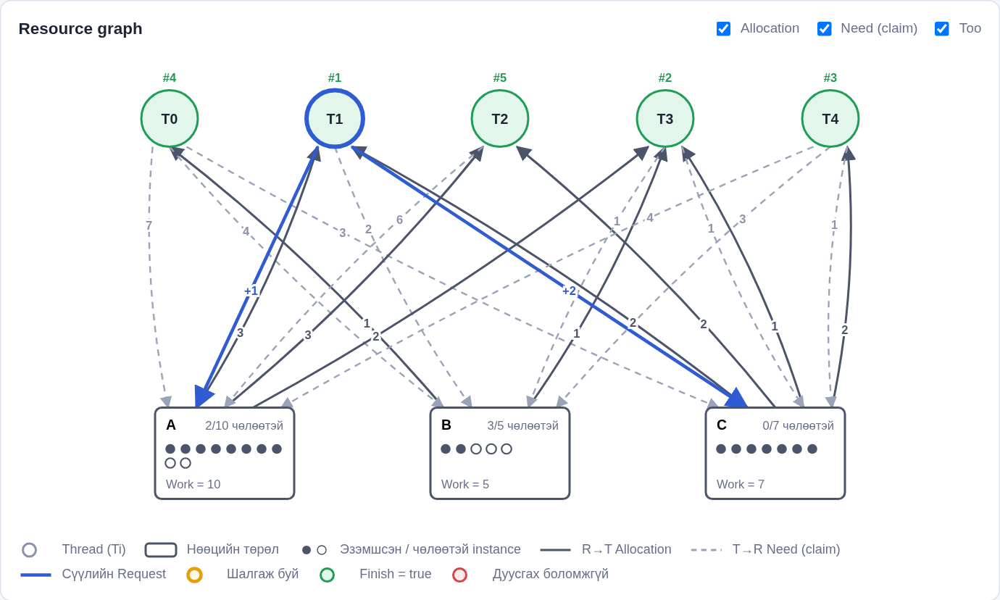

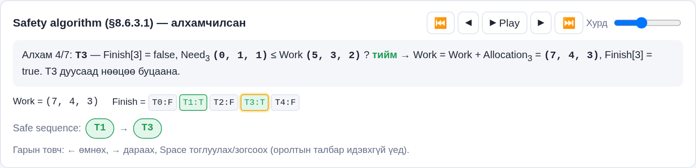

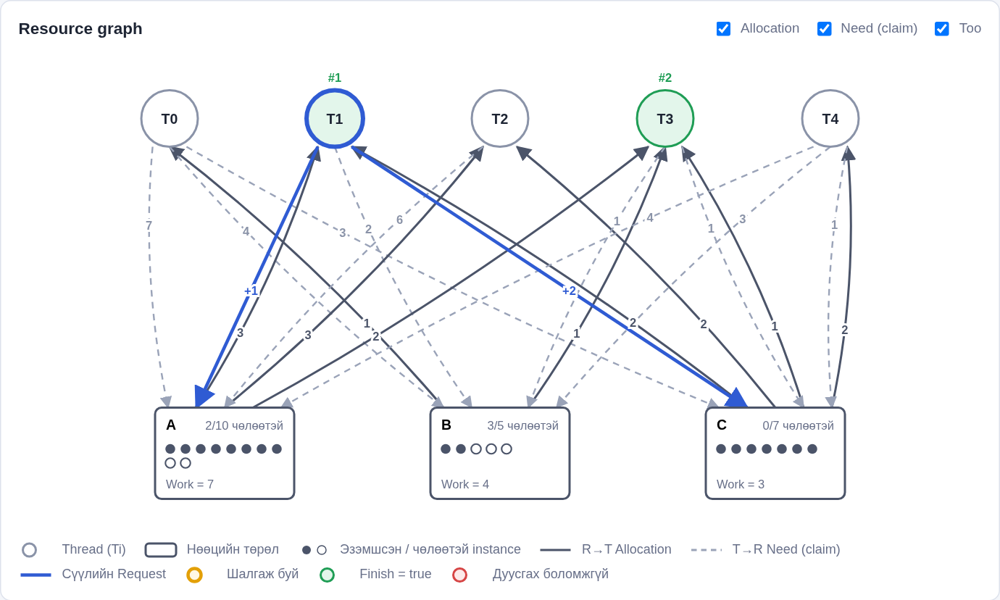

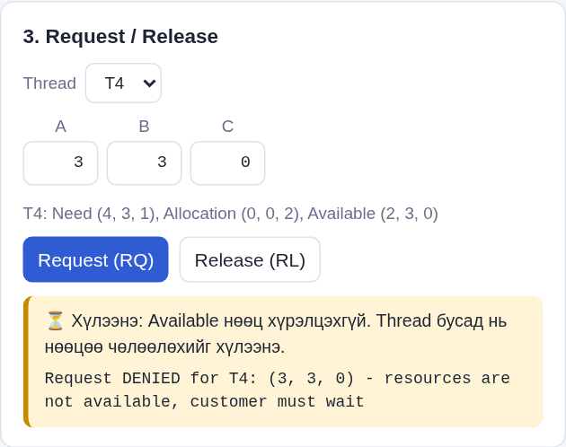

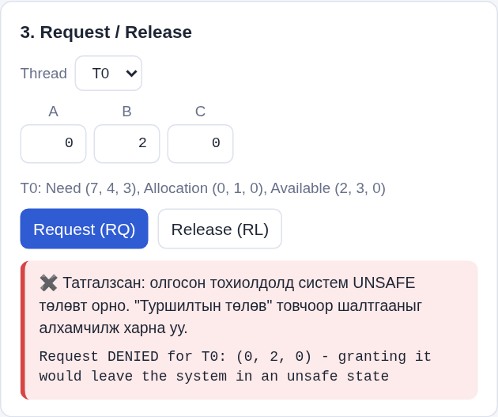

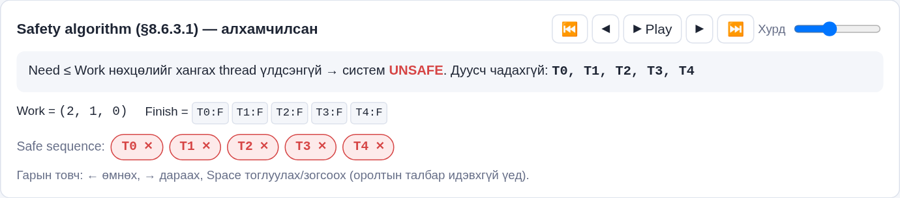

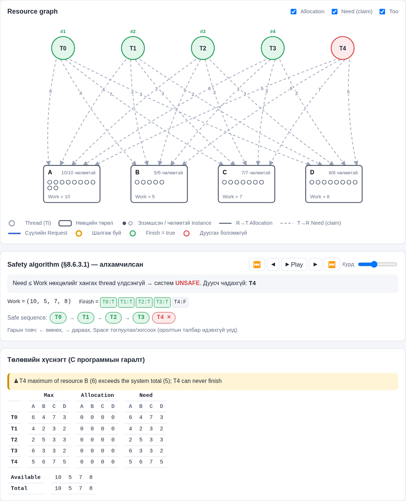

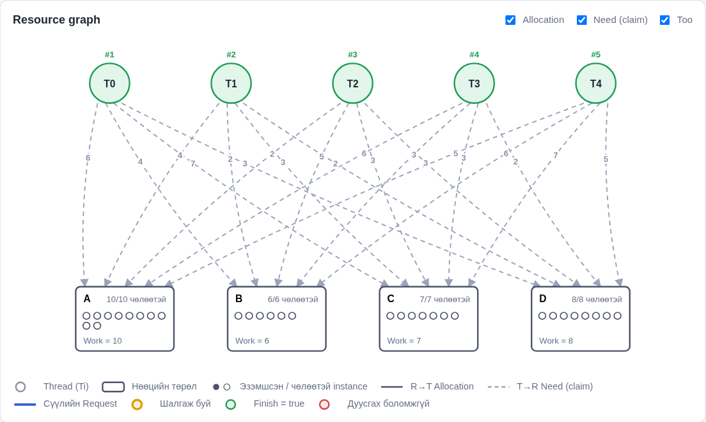

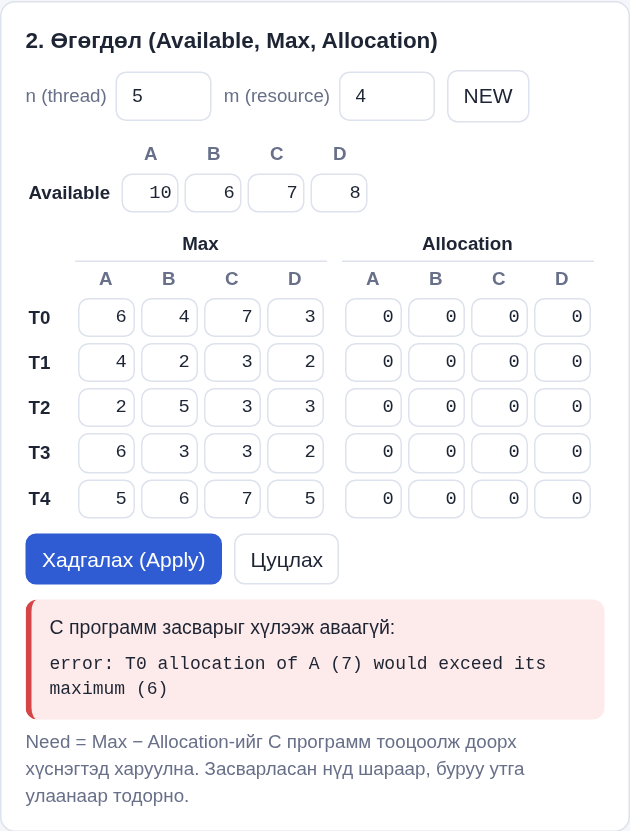


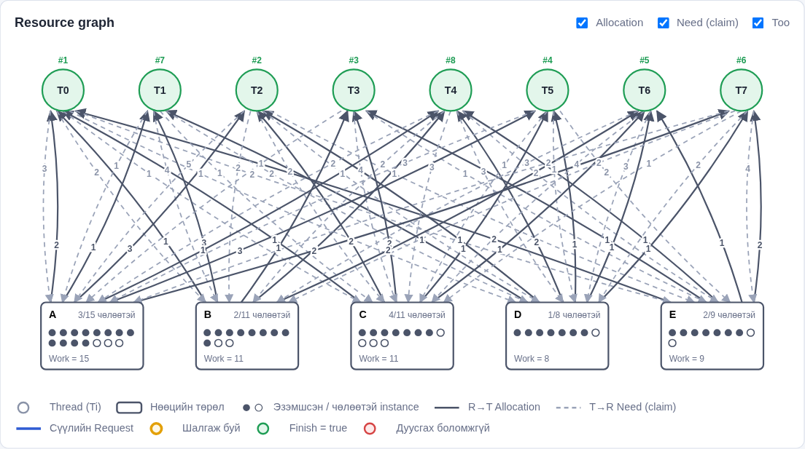

## 8.4 Deadlock detection (§8.7.2): CLI-ийн бодит гаралт

Номын §8.7.2 жишээ: 5 thread, нөөц A=7, B=2, C=6, `Available = (0, 0, 0)`,
Allocation `010, 200, 303, 211, 002` (`tests/data/detect_alloc.txt`). Detection
Max-ийг ашигладаггүй, `detect_max.txt` нь зөвхөн `Allocation <= Max` шалгалтыг
давуулахад хэрэгтэй.

```
banker> WAIT 1 2 0 2
banker> WAIT 3 1 0 0
banker> WAIT 4 0 0 2
banker> DETECT
Deadlock detection: Work = Available = (0, 0, 0)
  T0   Request (0, 0, 0) <= Work (0, 0, 0) ? yes -> Work = (0, 1, 0), Finish[0] = true
  T1   Request (2, 0, 2) <= Work (0, 1, 0) ? no
  T2   Request (0, 0, 0) <= Work (0, 1, 0) ? yes -> Work = (3, 1, 3), Finish[2] = true
  T3   Request (1, 0, 0) <= Work (3, 1, 3) ? yes -> Work = (5, 2, 4), Finish[3] = true
  T4   Request (0, 0, 2) <= Work (5, 2, 4) ? yes -> Work = (5, 2, 6), Finish[4] = true
  T1   Request (2, 0, 2) <= Work (5, 2, 6) ? yes -> Work = (7, 2, 6), Finish[1] = true
No deadlock: every thread can finish.
banker> WAIT 2 0 0 1
banker> DETECT
...
System is DEADLOCKED. Deadlocked threads: T1 T2 T3 T4
```

| № | Тест | Хүлээгдсэн | Бодит |
|---|------|------------|-------|
| 24 | §8.7.2, эхний Request матриц | Deadlock байхгүй | `No deadlock`, дараалал T0, T2, T3, T4, T1 (✔) |
| 24 | T2 нэмэлт C (0,0,1) хүсэх | T1, T2, T3, T4 deadlock | `DEADLOCKED: T1 T2 T3 T4`, номтой таарна (✔) |
| 25 | WAIT хийгээгүй | Deadlock байхгүй | `No deadlock` (✔) |
| 25 | Буруу WAIT (customer 9, 2 утга, сөрөг, тоо биш, аргументгүй) | Бүр ойлгомжтой алдаа | `error: ...` 5 мессеж (✔) |
| 25 | T1 нь A-г 8 хүлээнэ (системд 7) | Зөвхөн T1 deadlock | `DEADLOCKED: T1` (✔) |
| 25 | `RESET`-ийн дараа | Request матриц цэвэр | `No deadlock` (✔) |

Хязгаарлалт: detection зөвхөн deadlock-ийг мэдээлнэ, сэргээхгүй (§8.8). UI-ийн
Resource graph дээр deadlock-д орсон thread-ийг тодруулах дүрслэл хараахан
нэмээгүй.

# 9. Хэлэлцүүлэг

**Үр дүнгийн тайлбар.** Номын §8.6.3.3, §8.6.1 жишээнүүдийн бүх дүгнэлтийг программ
давтсан. Энэ нь safety ба resource-request algorithm зөв хэрэгжсэнийг харуулна. Safe
sequence номынхоос (`<T1, T3, T4, T2, T0>`) өөр гарсан шалтгаан нь манай хэрэгжилт
thread-уудыг индексийн дарааллаар давтан шалгадагт оршино. Safe sequence ганц биш тул энэ
нь алдаа биш. Харин stepper дээр яг энэ дарааллыг алхам бүрээр нь харж болно.

**Номын жишээ оролтын ажиглалт.** Programming Project-ийн тайлбарт өгсөн Maximum файлын
сүүлийн мөр `5,6,7,5` нь B нөөцөөс 6 шаардана. Гэтэл `./a.out 10 5 7 8` үед B-ийн нийт тоо 5.
Тиймээс T4 хэзээ ч дуусахгүй, систем эхнээсээ unsafe болж бүх `RQ` татгалзагдана
(тайлбарын жишээ `RQ 0 3 1 2 1` ч мөн адил). Манай программ ачаалах үед анхааруулга гаргаж, UI дээр T4-ийг
улаанаар тэмдэглэнэ. Available-ийг `10 6 7 8` болгоход хүсэлтүүд хэвийн шийдэгдэнэ
(Зураг 8, 9).

**UI-ийн бодит ажиллагаатай нийцэл.** UI нь алгоритмыг JavaScript дээр дахин бичээгүй.
Бүх шийдвэрийг C программ гаргадаг тул CLI, тест, UI гурав нэг л кодыг ашиглана. UI-ийн
консолд `*`, `SAFE` бичихэд CLI-тэй ижил гаралт гарна (Зураг 11).

**Хязгаарлалт.**

- Номын 10-р хэвлэлийн төсөл нь нэг урсгалтай интерактив программ шаарддаг тул харилцагчдыг
  тусдаа thread болгон mutex-ээр хамгаалаагүй.
- n > 10 үед граф дээрх ирмэгүүд давхцаж уншихад хэцүү болно (шүүлтүүр, hover-оор
  хэсэгчлэн шийдсэн).
- Windows дээр шууд биш, WSL ашиглан ажиллана (`open_memstream`).
- UI сервер нь локал, нэг хэрэглэгчид зориулагдсан. Бүх tab нэг C процессыг хуваалцана.
- Apply-ийн дунд C алдаа илэрвэл түүнээс өмнөх засвар хэрэгжсэн хэвээр үлдэнэ
  (SAVE хийгдэхгүй тул Reset-ээр буцна).

# 10. Дүгнэлт

- Сурах бичгийн Banker's Algorithm Programming Project-ийн бүх үндсэн шаардлагыг C хэл дээр
  хэрэгжүүлсэн. Номын функцийн прототип, командын мөр, файлын формат, `RQ`/`RL`/`*`
  командуудыг хадгалсан.
- Safety algorithm-ийн алхам бүрийг харуулах, Allocation файл, засварлах командууд, JSON
  горимоор программыг өргөтгөсөн.
- Resource graph бүхий интерактив UI нь C программтай шууд холбогдож, өгөгдөл засварлах,
  хүсэлт оруулах, safety algorithm-ийг алхамчлах, татгалзсан хүсэлтийн шалтгааныг харуулах
  боломжтой.
- Номын жишээнүүдийн үр дүнг бүрэн давтаж, 95 автомат тестээр зөв ажиллагааг нотолсон
  (62 unit шалгалт, 25 CLI тохиолдол, 8 серверийн тест).
- Deadlock detection (§8.7.2) нэмж, номын жишээгээр (T1..T4 deadlock) батлав.
- Номын жишээ оролт эхнээсээ unsafe байгааг илрүүлсэн.

# GitHub дээрх ажиллагаа

Төслийг эхнээс нь GitHub дээр public repository болгон байршуулж, ажлын алхам бүрийг тусад
нь commit хийсэн. Repository: `github.com/Energyshifter8/V-1-13-Bankers-Algorithm`.

| Үе шат | Commit-ийн жишээ |
|---|---|
| Төлөвлөлт | `Initial commit`, `docs: add work plan, team roles and test plan` |
| C core | `core: define bank data structures`, `core: implement safety algorithm`, `core: implement resource-request algorithm`, `core: implement resource release` |
| CLI | `cli: interactive RQ/RL/* commands`, `cli: add SAFE command`, `cli: optional -a allocation file`, `cli: JSON mode (-j)` |
| Тест | `tests: add C unit tests`, `tests: add CLI scenario and error tests`, `tests: server/JSON integration tests` |
| UI | `ui: add local Python server`, `ui: resource graph`, `ui: step-by-step safety algorithm player`, `ui: request/release panel ... trial-state view` |
| Засвар | `cli: reject over-long input lines`, `tests: commit expected CLI outputs (were hidden by *.out in .gitignore)`, `ui: stop a batch at the first error` |
| Баримт бичиг | `docs: architecture diagram and screenshots`, `docs: user and operational manual`, `docs: report` |

Commit-ийн бүрэн түүхийг `git log --oneline` эсвэл GitHub-ийн *Commits* хуудаснаас харна.

## Deadlock detection нэмсэн ажил (namuunaa)

`feature/deadlock-detection` branch дээр тусдаа commit-үүдээр хийж, Pull Request-ээр
хүргэсэн:

| Commit | Агуулга |
|--------|---------|
| `core: add deadlock detection algorithm (OSC 8.7.2)` | `banker.c`, `banker.h` |
| `cli: add WAIT and DETECT commands` | `main.c` |
| `tests: update HELP expected output for WAIT and DETECT` | `tests/expected/07_command_errors.out` |
| `tests: add deadlock detection cases (OSC 8.7.2 example and edge cases)` | `tests/cases/24_*`, `25_*`, `tests/data/detect_*` |
| `docs: ...` | Тайлан, Manual, README |

# Ашигласан материал

1. A. Silberschatz, P. B. Galvin, G. Gagne. *Operating System Concepts*, 10th ed. Wiley, 2018.
   Бүлэг 8 (Deadlocks): §8.3.2, §8.6.1, §8.6.2, §8.6.3; Programming Project "Banker's Algorithm".
2. F.CSM302 Үйлдлийн систем, "Бие даалт 1" удирдамж, "Харилцан шүүмжийн удирдамж",
   "Сэдэв ба шүүмж хийх хуваарилалт".
3. ISO/IEC 9899:2011 (C11). IEEE Std 1003.1-2008 (POSIX) — `open_memstream`, `isatty`.
4. Python 3 баримт бичиг: `http.server`, `subprocess`, `unittest`.
5. MDN Web Docs: SVG, ES modules, Fetch API.
